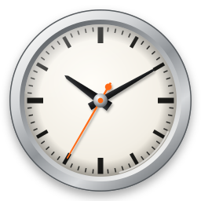
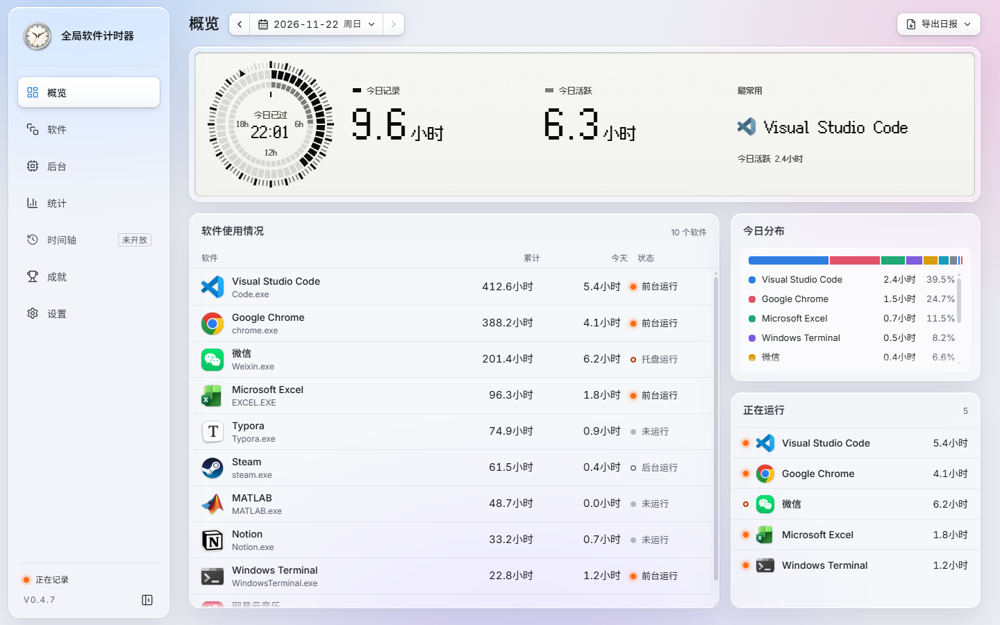

<div align="center">



# Global Software Timer

### Screen time for Windows

**A small desk instrument in your system tray that records which programs your day actually goes to.**

Runs in the Windows tray · records automatically · keeps every record on your computer

[English](./README.en.md) · [中文](./README.md)

<a href="https://github.com/Awes0meE/Global-Software-Timer/releases/latest"><b>⬇️ Download the latest release</b></a>

<br />
<br />

<picture>
  <source media="(prefers-color-scheme: dark)" srcset="./docs/assets/ui-overview-dark.png" />
  <source media="(prefers-color-scheme: light)" srcset="./docs/assets/ui-overview-light.png" />
  
</picture>

<sub>Screenshots use sample data and follow GitHub's light or dark theme.</sub>

</div>

> [!NOTE]
> The app's interface is in Simplified Chinese only for now. This page is an English summary of the [Chinese README](./README.md), which has the full documentation.

## What it is

Global Software Timer (GST) is a free, open-source tray app for Windows 10 and 11. It samples the running programs every 5 seconds and shows, on a pixel e-ink style dashboard, how long each one ran today and how long you actually used it. There is nothing to start or stop, no account and no cloud: install it once, and it records in the background, also while its window is closed.

## Features

- **Automatic tracking**: lives in the tray, starts with Windows by default, and records which programs run without any start or stop button.
- **Open versus in use**: *recorded* time is how long the computer was on; *active* time only counts minutes with keyboard or mouse input; the 软件 (Software) page also counts how long each program had the focus.
- **Noise filtered out**: system processes, drivers, updaters, installers and helper processes are not counted. Programs with no window and no tray icon are listed separately on the 后台 (Background) page.
- **Statistics**: totals for the last 7 days, this week, this month, the last 30 days, this year or a custom range of up to 366 days, each compared with the previous range of the same length: daily recorded and active time, a ranking with rank changes, programs left open but unused, launches and daily rhythm.
- **Achievements without goals**: a dot heatmap of the days you used the computer, streaks, personal records and milestones per program. No targets, countdowns or reminders.
- **Past days**: step back day by day, or pick a date in the calendar, to see what you used and what ran in the background.
- **Export, backup and restore**: save each page as a CSV file, export and import settings, back up the whole database in one click and restore it from 设置 (Settings). Files are written only where you choose in the save dialog.
- **Share posters**: save a day's screen time, or a milestone a program reached, as a portrait PNG poster, drawn on your computer.
- **Personal touches**: 8 accent colours (including the Windows accent), 5 e-ink palettes, light and dark themes, week start, start page, a larger text size, reduced motion, decimal hours (`8.3小时`) or hours and minutes.
- **Keyboard shortcuts**: `Ctrl+1` to `Ctrl+6` switch pages, `Ctrl+,` opens Settings, `Ctrl+←` / `Ctrl+→` step through days.
- **Small**: built with Tauri on the WebView2 that Windows already has; the installer is about 6 MB.

## Privacy

- Every record stays in a local SQLite database on your computer. There is no account, no telemetry and no upload.
- GST does not read window titles, document names, web page titles, keystrokes, mouse positions, file contents or browser history. It only sees which programs are running, which one has the focus, and whether there was any input in the last few minutes.
- Up to v0.4.5, GST makes no network request at all. From v0.4.6 it can check for updates, but only when you press 检查更新… (Check for updates) in Settings and then agree in a dialog, every time; the check asks GitHub for the latest version and sends no usage data.
- It runs as a normal user-space app and never asks for administrator rights.

Details: [PRIVACY.md](./PRIVACY.md).

## Download and install

Requirements: Windows 10 or 11 (x64). The interface uses Microsoft Edge WebView2, which Windows 11 includes; on Windows 10 the installer downloads it when it is missing.

1. Open the [latest release](https://github.com/Awes0meE/Global-Software-Timer/releases/latest) and download `Global.Software.Timer_<version>_x64-setup.exe` (recommended) or the `.msi`.
2. Run it. The installers are not code-signed yet, so Windows SmartScreen may show "Windows protected your PC"; choose **More info → Run anyway**. You can check the file against `SHA256SUMS.txt` on the release page:

   ```powershell
   Get-FileHash .\Global.Software.Timer_<version>_x64-setup.exe -Algorithm SHA256
   ```

3. Open it once. It then starts with Windows (you can turn that off in Settings) and lives behind the small clock icon in the tray.

Upgrading: install the new version over the old one; your records and settings stay.

## Code signing policy

The project has applied to the SignPath Foundation for free code signing. See the [code signing policy](./CODE_SIGNING_POLICY.md).

## Feedback

- Report a problem: [bug report form](https://github.com/Awes0meE/Global-Software-Timer/issues/new?template=bug_report.yml)
- Suggest a feature: [feature request form](https://github.com/Awes0meE/Global-Software-Timer/issues/new?template=feature_request.yml)
- Questions and ideas: [GitHub Discussions](https://github.com/Awes0meE/Global-Software-Timer/discussions)
- Security issues: please report them privately as described in [SECURITY.md](./SECURITY.md).

Issues and discussions in English are welcome.

## Built with

Tauri v2, Rust, React and TypeScript, and SQLite. Development notes are in [CONTRIBUTING.md](./CONTRIBUTING.md); release history is in [CHANGELOG.md](./CHANGELOG.md).

## License

Copyright (C) 2026 Global Software Timer Contributors. See [LICENSE](./LICENSE). Releases up to v0.4.5 are MIT-licensed; from v0.4.6 the project moves to GPL-3.0-or-later, and the names and clock icon are reserved for the official app.
