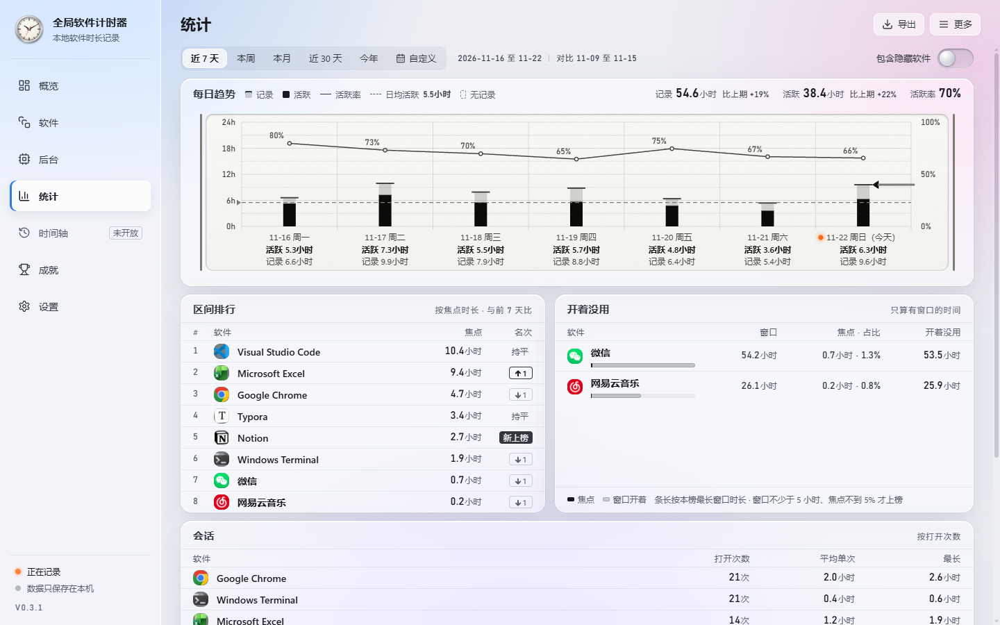
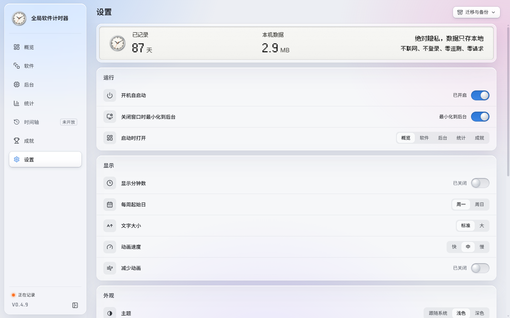
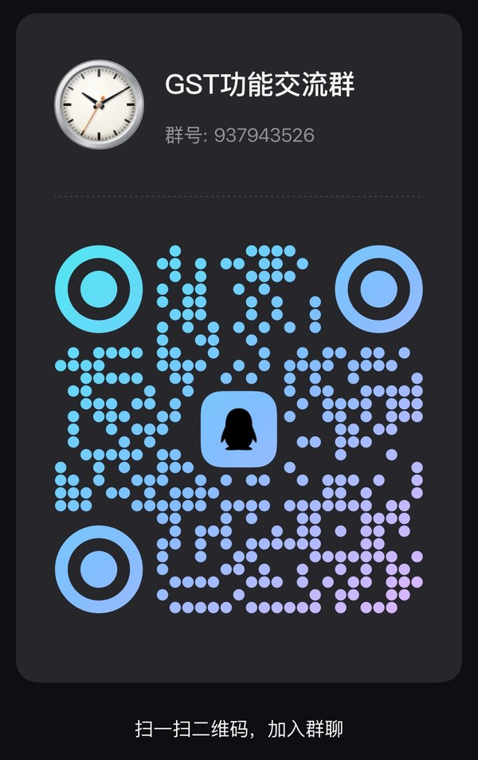
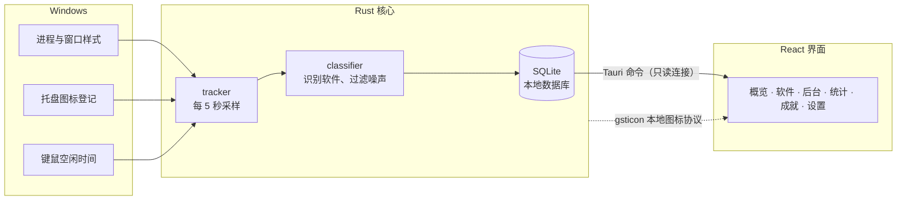
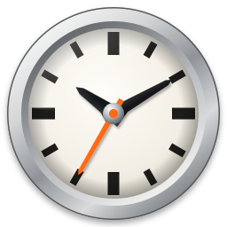

<a id="top"></a>

<div align="center">


# 全局软件计时器

### Windows 也有「屏幕使用时间」了

**一台放在桌面角落的计时仪器，替你记下每天的时间都花在了哪些软件上。**

Windows 托盘常驻 · 全自动记录 · 数据只存在本机

[English](./README.en.md) · [中文](./README.md)

<p>
  <a href="https://github.com/Awes0meE/Global-Software-Timer/releases/latest"></a>
  <a href="https://github.com/Awes0meE/Global-Software-Timer/releases"></a>
  
  <a href="./LICENSE"></a>
</p>

<p>
  
  
  
  
  
  
  
  
</p>

<h3>
  <a href="https://github.com/Awes0meE/Global-Software-Timer/releases/latest">⬇️ 下载最新版</a>
  <span>&nbsp;·&nbsp;</span>
  <a href="#features">功能</a>
  <span>&nbsp;·&nbsp;</span>
  <a href="#screenshots">界面</a>
  <span>&nbsp;·&nbsp;</span>
  <a href="#export">导出</a>
  <span>&nbsp;·&nbsp;</span>
  <a href="#privacy">隐私</a>
  <span>&nbsp;·&nbsp;</span>
  <a href="#faq">问答</a>
  <span>&nbsp;·&nbsp;</span>
  <a href="#feedback">反馈</a>
  <span>&nbsp;·&nbsp;</span>
  <a href="#development">开发</a>
</h3>

<br />

<picture>
  <source media="(prefers-color-scheme: dark)" srcset="./docs/assets/ui-overview-dark.png" />
  <source media="(prefers-color-scheme: light)" srcset="./docs/assets/ui-overview-light.png" />
  
</picture>

<sub>截图均为示例数据，会跟随 GitHub 的浅色 / 深色主题切换。</sub>

</div>

<br />

一天开着电脑十几个小时，真正在用的是哪几个软件？写代码写了多久，聊天软件挂了多久，哪个程序又在后台悄悄跑了一整天？

**全局软件计时器**（Global Software Timer，简称 GST）在托盘里安静地帮你记下每个软件的运行时长，再用一块像素墨水屏，把今天的数字摆在你面前。不用手动开始，不用注册账号；除非你点「检查更新…」并同意，它不会联网。

> 💡 **小贴士**：装好之后基本不用管它。默认开机自启，关掉主窗口也照常记录；想看数据时，点一下右下角托盘里的小时钟就行。

<a id="features"></a>

## ✨ 功能亮点

<table>
  <tr>
    <td width="33%" valign="top">
      <h3>🕒 全自动计时</h3>
      <p>常驻托盘，每 5 秒采样一次，自动识别正在运行的软件。不用点开始、不用点暂停，关掉主窗口也照常记录。</p>
    </td>
    <td width="33%" valign="top">
      <h3>🎯 分清“开着”和“在用”</h3>
      <p><b>今日记录</b>是电脑开着的时间，<b>今日活跃</b>只算 5 分钟内有键鼠操作的部分；软件页还会单独统计每个软件拿到前台焦点的时长。</p>
    </td>
    <td width="33%" valign="top">
      <h3>🧹 自动过滤噪声</h3>
      <p>系统进程、驱动、更新程序、安装程序和各种辅助进程默认不计入；没有窗口、也没有托盘图标的常驻程序集中放在「后台」页。</p>
    </td>
  </tr>
  <tr>
    <td width="33%" valign="top">
      <h3>🔒 数据只在本机</h3>
      <p>所有记录都存在本机的 SQLite 数据库里。只在你点「检查更新…」并同意时联网，不需要账号、没有遥测，也不读取窗口标题、文档名和网页标题。</p>
    </td>
    <td width="33%" valign="top">
      <h3>🎛️ 桌面仪器质感</h3>
      <p>云母玻璃外壳里嵌着像素字墨水屏读数窗，配一圈 24 小时分段表盘。浅色 / 深色两套主题，默认跟随 Windows。</p>
    </td>
    <td width="33%" valign="top">
      <h3>🔍 中文友好的搜索</h3>
      <p>已发现软件支持中文、英文、拼音全拼和拼音首字母离线搜索，输入 <code>wx</code> 或 <code>weixin</code> 都能找到「微信」。</p>
    </td>
  </tr>
</table>

还有这些细节：

- 📈 **多天统计**：统计页按近 7 天、本周、本月、近 30 天、今年或自定义区间（最长 366 天）汇总，每个数字都和上一个等长区间对比；能看到每天的记录与活跃时长、软件焦点排行与名次涨跌、「开着没用」的软件、打开次数和作息。
- 🏆 **成就只记录、不设目标**：成就页用点阵热力图摆出近 90 天（可切换半年、一年）用过的日子，再加上连续天数、个人纪录和按软件累计焦点时长点亮的里程碑；没有目标、倒计时，也不发提醒。
- 📅 **翻看往日**：概览和后台页可以往前翻，或者在日历里直接挑一天，看那天用了哪些软件、后台跑了什么。
- 📤 **导出、备份与恢复**：各页的数据可以存成 CSV 表格，设置和名单可以导出、导入，整个数据库可以一键备份，也能在设置里从备份恢复；文件只写到你在保存对话框里选的位置。
- 🖼️ **分享海报**：把某一天的屏幕时间，或者某个软件点亮的里程碑，存成一张竖版 PNG 海报，发到聊天软件或朋友圈；海报在本机画好，不联网。
- 📦 **小巧**：EXE 安装包约 8 MB。基于 Tauri，用系统自带的 WebView2 显示界面，不用再打包一整个浏览器。
- 🔄 **升级不断档**：软件更新后换了带版本号的安装目录，仍然算同一个软件，累计时长接着往上加。
- 🧭 **托盘软件也算数**：在 Windows 11 上，最小化到托盘的软件（比如聊天软件）同样计入运行时长。
- ⭐ **特别关注与隐藏**：常用的软件加入特别关注，单独看它的前台、后台和活跃时长；不想看到的软件可以隐藏，记录照常保留。
- ⏱️ **两种时长格式**：默认显示 `8.3小时` 这样的小数小时，也可以在设置里改成 `8小时18分钟`。
- 🎨 **主题色与墨水屏配色**：8 种主题色（含跟随 Windows）给开关、选中项、导航图标和背景光晕换色，5 套墨水屏配色换读数屏和日历的纸色与墨色。
- 🗓️ **按你的习惯来**：每周从周一还是周日开始、启动后先显示哪一页、文字要不要放大、要不要减少动画，都能在设置里选。
- 🚪 **关闭行为自己选**：第一次关闭窗口时会问你是最小化到托盘还是直接退出，之后可以在设置里改。

<a id="screenshots"></a>

## 🖼️ 界面一览

### 软件

特别关注的软件分别显示今日和共计的前台、后台、活跃时长，以及上次打开的时间；下方是隐藏软件列表和可以离线搜索的已发现软件。

<picture>
  <source media="(prefers-color-scheme: dark)" srcset="./docs/assets/ui-software-dark.png" />
  <source media="(prefers-color-scheme: light)" srcset="./docs/assets/ui-software-light.png" />
  
</picture>

### 统计

选一段日期，走纸记录仪式的主图画出每天的记录和活跃时长；下面是作息、按焦点时长的区间排行、开着没用榜和会话，全部和上一个等长区间对比。

<picture>
  <source media="(prefers-color-scheme: dark)" srcset="./docs/assets/ui-statistics-dark.png" />
  <source media="(prefers-color-scheme: light)" srcset="./docs/assets/ui-statistics-light.png" />
  
</picture>

### 成就

墨水屏里按月排开的活跃热力图，配上当前和最长连续天数；下方是个人纪录、10 到 1000 小时的里程碑（6666 小时为终极成就），以及近 30 天新出现和没再打开的软件。

<picture>
  <source media="(prefers-color-scheme: dark)" srcset="./docs/assets/ui-achievements-dark.png" />
  <source media="(prefers-color-scheme: light)" srcset="./docs/assets/ui-achievements-light.png" />
  
</picture>

<table>
  <tr>
    <th width="50%">后台</th>
    <th width="50%">设置</th>
  </tr>
  <tr>
    <td valign="top">
      <picture>
        <source media="(prefers-color-scheme: dark)" srcset="./docs/assets/ui-background-dark.png" />
        <source media="(prefers-color-scheme: light)" srcset="./docs/assets/ui-background-light.png" />
        
      </picture>
      <br />
      没有窗口、也不在托盘里的第三方程序，按软件分组列出实时 CPU、内存、进程数，以及今天的后台时长和 CPU 时间。
    </td>
    <td valign="top">
      <picture>
        <source media="(prefers-color-scheme: dark)" srcset="./docs/assets/ui-settings-dark.png" />
        <source media="(prefers-color-scheme: light)" srcset="./docs/assets/ui-settings-light.png" />
        
      </picture>
      <br />
      开机自启、关闭窗口时的行为、启动时打开的页面、时长格式、每周起始日、主题、主题色和墨水屏配色，都在这里一键切换；「数据」一组能打开数据文件夹、从备份恢复，页头的「迁移与备份」管导出、导入设置和备份数据。
    </td>
  </tr>
</table>

<a id="metrics"></a>

## 📊 每个数字是怎么算的

| 指标 | 含义 |
| :-- | :-- |
| **今日记录** | 今天 GST 在运行并记录到的开机时间。 |
| **今日活跃** | 今日记录里，键盘或鼠标在 5 分钟内有操作的部分。 |
| **最常用** | 今天活跃时长最多的软件；今天还没有活跃时长时，取今天运行时长最多的软件。 |
| **当日记录 / 当日活跃** | 翻看往日时，今日记录、今日活跃改叫这两个名字，口径不变；表格里的累计算到那天结束为止。 |
| **前台运行** | 软件有一个任务栏上能看到的窗口。不要求它正被点选，几个软件可以同时处于前台运行。 |
| **托盘运行** | 没有任务栏窗口，但在右下角通知区域有图标（需要 Windows 11）。 |
| **后台运行** | 进程还在，但既没有窗口也没有托盘图标。 |
| **往日的峰值内存** | 后台页看往日时，墨水屏上的峰值内存是各个软件当天各自峰值的和。这些峰值不一定出现在同一时刻，所以它可能比当天任何一刻同时占用的内存都大。 |
| **软件页的“活跃”** | 软件拿到 Windows 前台焦点的时间，不看键鼠是否空闲。 |
| **统计、成就页的“焦点”** | 和软件页的“活跃”同一口径。这两页里整台电脑的数字（每日趋势、热力图、连续天数）用今日活跃的键鼠口径，软件的数字（排行、开着没用、里程碑）用焦点。 |
| **作息** | 工作日、周末日均活跃按区间内全部工作日、周末日平均，没有记录的日子也算进去；日均开机时长只按有记录的日子平均；最早、最晚记录取各天的中位时间。条长满格为 24 小时。 |
| **区间排行** | 按区间内的焦点时长排名，名次涨跌和前一个等长区间比。 |
| **开着没用** | 区间内有窗口的时间不少于 5 小时、焦点却不到窗口时间 5% 的软件；托盘和后台时间不算。条长按本榜最长的窗口时长。 |
| **会话** | 按区间内的打开次数排序。 |
| **无软件明细** | 这些天只记了整天的总时长，没有分软件的记录，所以不计入区间排行、开着没用和会话。 |
| **用过 / 没用** | 热力图和连续天数里，活跃不到 5 分钟的日子不算在内，记为“没用”，免得开机看一眼也被记上。 |
| **热力图深浅** | 用过的日子按当天活跃时长线性加深，活跃 12 小时及以上墨色最深；没用的日子是空框，还没到的日子是虚线框。 |
| **里程碑** | 按每个软件的累计焦点时长点亮。 |
| **使用天数** | 区间汇总表格和成就海报里，某个软件当天焦点满 5 分钟（300 秒）才算用了一天；只开着窗口、或只在后台的日子不算。区间汇总只数所选区间里的日子，成就海报数全部历史。 |
| **软件来去** | 按软件有窗口的日子算：新面孔是近 30 天里第一次有窗口的软件，30 天未打开是近 30 天都没有窗口的软件。 |

> ℹ️ **说明**：概览按软件名称合并，软件页按软件身份汇总，两边的分组和后台口径不同，所以总数不一定完全相等。

<a id="settings"></a>

## ⚙️ 设置与个性化

设置页从上到下是本机状态、运行、显示、外观、数据和隐私几组，改了马上生效，并存在本机数据库里。

- **运行**：开机自启动、关闭窗口时最小化到后台，以及 **启动时打开**：GST 启动后先显示概览、软件、后台、统计还是成就。它只在 GST 启动时起作用（开机自启、自己打开，或者从备份恢复后的重启）；从托盘打开窗口时，还是停在你上次看的那页。
- **显示**：显示分钟数；**每周起始日**选周一或周日，日历、统计页的「本周」、成就页热力图、每日趋势的周标记和软件页的「这周X / 上周X」都跟着变，星期名称、工作日 / 周末、导出的表格和海报不变；**文字大小**选「标准」或「大」，「大」把整个界面（文字、图标、读数屏）放大到 125%，窗口最小尺寸随之变成 1280×800，侧栏自动收成图标条；**减少动画**打开后，开关、弹窗和指示灯呼吸等动效都关掉，状态照样切换，只是没有过渡；关着时跟随 Windows 的「动画效果」设置。
- **外观**：
  - 主题：跟随系统、浅色或深色。
  - **主题色**：跟随 Windows、蓝、青、绿、紫、玫红、琥珀、石墨，换开关、选中项、导航图标、焦点环和背景光晕的颜色。默认的蓝和以前一模一样。跟随 Windows 取 Windows 的强调色，太亮或太暗时会自动调深浅，保证看得清；读不到时用蓝。正在记录的橙色指示灯、软件的身份色和海报不跟着变。
  - **墨水屏配色**：极光（默认）、石墨、夜蓝、暖纸、墨绿，换读数屏、后台概况条、日历、走纸记录仪和成就页热力图的纸色与墨色，浅色、深色各一套。海报不跟着变。
- **数据**：数据文件夹「打开」在资源管理器里打开数据库所在的文件夹；「从备份恢复」见[下文](#restore)。

启动时打开、每周起始日、主题、主题色和墨水屏配色都能用键盘选：Tab 进到一组，方向键、Home、End 移动并选中。「导出设置」也会带上这些选择。

<a id="export"></a>

## 📤 翻看往日、导出与备份

### 翻看往日

概览和后台页的页头有一组日期键：`‹` 往前翻一天，`›` 往后翻一天，点中间的日期会弹出日历，直接点某一天就跳过去；点日历顶上的年月可以切到月份视图。能选的日子从开始记录的那天到今天为止。看往日时，日期键右边多一个「今天」键，点一下就回到今天。

往日只是回看已经存下的记录：概览的读数和表格改叫「当日记录」「当日活跃」「当日」，「正在运行」收起来，「当日分布」占满右栏；后台页改看那天每个程序的峰值进程数、峰值内存、后台时长和 CPU 时间。看哪一天不会被保存，重新打开 GST 时总是回到今天；停在今天时数字照常实时刷新，过了午夜会自动换到新的一天。

统计页的「自定义」区间用的也是这个日历：先点开始日，再点结束日。

### ⌨️ 快捷键

| 快捷键 | 作用 |
| --- | --- |
| `Ctrl+1` … `Ctrl+6` | 按侧栏顺序打开概览、软件、后台、统计、成就、设置（还没开放的时间轴跳过） |
| `Ctrl+,` | 打开设置 |
| `Ctrl+←` / `Ctrl+→` | 在概览和后台往前、往后翻一天，到头就停 |

光标在搜索框里或者对话框开着时，这些键留给它们自己用。

### 🗂️ 收起侧栏

侧栏底部、版本号右边的小按键可以把侧栏收成一条只有图标的窄条，把地方让给内容；鼠标停在图标上会显示页名，再点一次就展开。宽窗口里收起或展开会记住，下次打开还是这样。窗口窄到界面宽度不足 1200（比如最小窗口，或者文字大小选了「大」）时，侧栏会自己收起；这时点开只管这一次，窗口拉宽再变窄又会收起。

### 导出表格与海报

每页页头都有一个导出键（设置页是「迁移与备份」，见下）。概览和统计页的导出键带一个小箭头，点开是菜单，再选要哪一种；软件、后台、成就页只有一种，点一下就存。存的时候会弹出 Windows 的保存对话框，默认打开「下载」文件夹，文件名已经填好。保存后右下角提示「已保存」，点「在文件夹中显示」会在资源管理器里选中这个文件；在对话框里点取消就什么都不写。

| 页面 | 按键 | 文件 | 里面有什么 |
| :-- | :-- | :-- | :-- |
| 概览 | 导出日报 → 日报海报… | `GST-日报-日期.png` | 正在看的那一天的分享海报：日期、当天的活跃时长（大字）、活跃占记录时长的进度条和当天的记录时长，下面是那天活跃最多的三个软件（那天没有活跃时长时按运行时长挑）。不含隐藏软件。 |
| 概览 | 导出日报 → 当日明细… | `GST-日报-日期.csv` | 正在看的那一天，概览表格里的每个软件一行（不含隐藏软件）：日期、软件名称、进程名、当日运行、当日活跃、累计运行。 |
| 软件 | 导出软件清单… | `GST-软件清单-日期.csv` | 特别关注、隐藏、已发现的每个软件各一行，「分组」列写明属于哪一组：状态、最近打开，以及今日和累计的前台、后台、专注时长。 |
| 后台 | 导出后台记录… | `GST-后台-日期.csv` | 正在看的那一天，每个后台程序一行：日期、软件名称、进程名、峰值进程数、峰值内存（MB）、后台时长、CPU 时间（秒）。不写当前 CPU 和状态，所以哪天导出的列都一样。 |
| 统计 | 导出报表 → 区间汇总… | `GST-统计-开始日至结束日.csv` | 当前区间里有焦点、窗口或后台时间的每个软件一行：排名、焦点、窗口开着、开着没用、打开次数、平均单次、最长单次、后台、使用天数。有排名的软件排在前面，按名次往下排；不在区间排行、开着没用或会话榜上的数字留空。 |
| 统计 | 导出报表 → 每日明细… | `GST-统计每日明细-开始日至结束日.csv` | 当前区间里每天每个软件一行（那天什么时间都没有的不写）：日期、软件名称、进程名、焦点、窗口开着、后台。按日期排，同一天里焦点多的在前。 |
| 成就 | 导出成就… | `GST-成就-软件名-日期.png` | 某一个软件的里程碑海报：图标和名称、点亮的最高一档（比如「100 小时」）和点亮那天的日期、使用天数、累计专注时长。文件名里的日期是点亮那天。 |

统计页的两张表和成就页的软件列表都跟随页面上的「包含隐藏软件」开关。

点「导出成就…」会先弹出「成就海报」对话框：左边是海报预览，右边列出点亮了里程碑的软件，档位高的在前，默认选中最近点亮的那个。点一下或用方向键换软件，直接打字可以跳到名字对得上的软件；点「保存图片」、按回车或双击一行就存。还没有软件点亮里程碑时，这个键是灰的，鼠标停上去会提示「暂无里程碑」。

所有表格都是带 BOM 的 UTF-8，Excel 直接打开不会乱码；时长是保留两位小数的小时，列名里写着单位；不含任何程序路径。以 `=`、`+`、`-`、`@` 开头的内容前面会加一个 `'`，免得表格软件把它当成公式运行。

海报是 1080×1440 的竖版 PNG，跟随 GST 当前的浅色 / 深色主题，背景不透明，放进 Word、PowerPoint 不会被缩成一半大小。上面只有软件名称、图标、时长、天数和日期，没有程序路径和进程名。海报在本机画好：字体（Inter 和思源黑体）随应用打包，图标取自本机的图标缓存，取不到图标的软件画成首字母方块；整个过程不联网。

### 迁移与备份

设置页页头的「迁移与备份」里有三项：

- **导出设置**（`GST-设置-日期.json`）：你自己改过的主题、主题色、墨水屏配色、时长格式、每周起始日、启动时打开、文字大小、减少动画和关闭窗口时的行为（没改过的留空，导入时不会拿默认值盖掉对方的选择），以及特别关注和隐藏软件两个名单。名单里每个软件只写软件名称、进程名和一串由软件身份算出的单向摘要（`sha256:…`），不写安装路径。文件里没有开机自启，也没有任何使用记录。
- **导入设置…**：选一个导出的设置文件（最大 1 MB），先弹出确认框，一行一项列出会变的设置（旧值 → 新值）、特别关注和隐藏软件各会多几个、本机没有的软件几个、已在另一个名单里的几个；点「导入」才写入。导入只往名单里加，不会删掉本机已有的条目；名单先按软件身份、再按进程名（不分大小写）对上本机见过的软件，对不上的、在本机已经在另一个名单里的都会跳过。
- **备份全部数据**（`GST-数据备份-日期.db`）：整个数据库的一份完整副本，包含全部使用记录和设置。备份时 GST 照常记录，不用先退出。

<a id="restore"></a>

### 从备份恢复

在「设置 → 数据 → 从备份恢复」里点「选择备份…」：

1. 选一个用「备份全部数据」存下的文件（`.db`、`.sqlite3` 或 `.sqlite`）。GST 先把它复制一份来检查，正在用的数据这时不会动。
2. 确认框列出备份文件、记录范围、里面有几个软件和文件大小。点「恢复并重启」，GST 会退出、换上备份，再自动打开；点「取消」什么都不改。
3. 重新打开后右下角提示「已从备份恢复」。换下来的数据会先自动另存到数据文件夹的 `backups\` 里（`GST-恢复前-日期-时间.db`），只留最近 3 份。

升级到 0.4.5 后第一次启动时，GST 会删掉早期版本（v0.1.x 及以前）留下的一份没人用的心跳日志，再把数据库压缩一下。用了几个月的数据库会从约 200 MB 缩到几 MB，之后备份和恢复都会快很多。删之前会先把完整数据另存为 `backups\GST-清理前-日期-时间.db`，只留最新的一份，确认没问题后可以自己删掉。

旧版本做的备份会自动升级；更新版本的 GST 做的备份、损坏的文件，以及正在使用的数据库本身都会被拒绝，并说明原因，当前数据不变。恢复后的数据库里存的设置（包括开机自启）在重启后生效。万一换上的数据打不开，GST 会退回原来的数据，提示「恢复没有完成，已保留原来的数据」。

> ⚠️ **注意**：恢复后，备份之后记下的时间都会被备份里的内容取代。想找回换下来的数据，可以用同样的方法恢复 `backups\` 里那份「恢复前」的副本。

GST 打不开、没法用上面的按钮时，也可以手动恢复：右键托盘里的小时钟选「退出」；在 `%APPDATA%\com.globalsoftwaretimer.app\` 里把 `global-software-timer.sqlite3` 和旁边的 `-wal`、`-shm` 文件改名留着；把备份文件复制进来，改名为 `global-software-timer.sqlite3`，再打开 GST。恢复用的 GST 不要比做备份时的版本旧。

<a id="install"></a>

## 📥 下载安装

**系统要求**：Windows 10 / 11（x64）。界面依赖 Microsoft Edge WebView2：Windows 11 已经自带，Windows 10 上缺少时安装程序会自动下载。

1. 打开 [Releases 页面](https://github.com/Awes0meE/Global-Software-Timer/releases/latest)，下载最新版的安装包：

   | 文件 | 说明 |
   | :-- | :-- |
   | `Global.Software.Timer_<版本号>_x64-setup.exe` | **推荐**。EXE 安装包，以后升级直接覆盖安装，原有记录会保留。 |
   | `Global.Software.Timer_<版本号>_x64_en-US.msi` | MSI 安装包，适合需要 MSI 的部署场景。 |
   | `SHA256SUMS.txt` | 校验值，可以用来确认安装包没有损坏或被改动。 |

2. 双击安装。安装包暂时没有数字签名（已在申请免费签名，见 [代码签名政策 Code signing policy](./CODE_SIGNING_POLICY.md)），Windows 可能会提示“Windows 已保护你的电脑”，点 **更多信息 → 仍要运行** 即可。
3. 安装后打开一次，它就会默认开机自启（可以在设置里关闭）。之后在右下角托盘找到小时钟图标，就能随时打开主界面。

**以后升级**：从 v0.4.6 起，可以在「设置 → 关于与反馈 → 当前版本」点「检查更新…」。GST 会先问你是否联网，同意后只向 GitHub 查询最新的版本号；有新版本时再问一次，点「更新并重启」就会先备份当前数据，再下载安装包、校验签名、装好并自动重启。GST 从不自己检查更新。v0.4.5 及更早的版本还没有这个功能，需要手动下载安装一次 v0.4.6，之后就可以在软件里升级了。

<a id="privacy"></a>

## 🔒 隐私承诺

<table>
  <tr>
    <th width="50%">✅ 会记录</th>
    <th width="50%">🚫 不会记录</th>
  </tr>
  <tr>
    <td valign="top">
      <ul>
        <li>软件的可执行文件身份和显示名称</li>
        <li>每个软件的运行时长（前台、托盘、后台）</li>
        <li>今日记录时长，以及按键鼠空闲状态算出的活跃时长</li>
        <li>软件页的特别关注、隐藏标记</li>
        <li>后台程序的路径、后台时长、CPU 时间、内存和进程数峰值</li>
        <li>逐段的焦点、活跃时段，以及每个软件有窗口的时段（只看窗口在不在，不读标题）</li>
        <li>本机设置：开机自启、关闭行为、时长格式、主题、主题色、墨水屏配色、每周起始日、启动时打开、文字大小、减少动画</li>
      </ul>
    </td>
    <td valign="top">
      <ul>
        <li>窗口标题</li>
        <li>文档名称</li>
        <li>网页标题和浏览记录</li>
        <li>键盘输入的内容</li>
        <li>鼠标坐标</li>
        <li>文件内容</li>
        <li>任何云端数据</li>
      </ul>
    </td>
  </tr>
</table>

- **不上传、不自己联网**：不上传任何使用数据，不需要账号，没有遥测。GST 唯一会联网的时候，是你点了「检查更新…」并在弹出的对话框里同意，而且每次都要重新同意，不会记住；启动时、定时和后台都不会联网。联网时只访问 GitHub（github.com 和它的下载服务器），查询最新的版本号，你同意更新时再下载安装包；不发送任何使用记录。
- **统计和成就不多收集**：这两页只用只读连接读取上面这些已有的本地记录来计算，不新增采集项，也不写入数据库。
- **导出只写到你选的地方**：表格、海报、设置文件和备份都要你在保存对话框里点了保存才写，只写到你选的那个位置，不会自动写到别的文件夹，也不会上传。表格、海报和设置文件不含程序路径；备份是整个数据库，包含全部使用记录和后台程序的路径，分享前请留意。
- **海报在本机画**：海报用本机的记录、本机缓存的图标和随应用打包的字体在 GST 窗口里画成图片，不联网取任何东西。
- **恢复只在本机数据文件夹里做**：从备份恢复只读你在打开对话框里选的那个文件，检查用的副本、换下来的数据都放在数据文件夹里，不会传到别处。
- **跟随 Windows 的强调色只读不存**：选了「跟随 Windows」主题色时（以及打开设置页、要画出它的色点时），GST 只读一下 Windows 的强调色，不写回 Windows，也不存进数据库。
- **不要管理员权限**：作为普通程序运行；开机自启用的是当前用户自己的自启动项，同样不需要管理员权限。
- **判断方式透明**：为了区分前台、托盘和后台，GST 只读取窗口样式和类名、进程命令行（只在内存里检查 `--type=` 这类辅助进程标记，不保存），以及 Windows 登记的托盘程序路径；不读取窗口标题，也不读取托盘图标的提示文字。
- **数据放在哪**：
  - 数据库：`%APPDATA%\com.globalsoftwaretimer.app\global-software-timer.sqlite3`
  - 恢复前的自动备份（v0.4.4 起）：同一个文件夹里的 `backups\`，每次从备份恢复前存一份当前数据，只留最近 3 份。
  - 清理前的自动备份（v0.4.5 起）：同样在 `backups\` 里，文件名是 `GST-清理前-…db`。升级后第一次启动删掉早期的心跳日志之前存一份完整数据，只留最新的一份，确认没问题后可以自己删掉。
  - 更新前的自动备份（v0.4.6 起）：同样在 `backups\` 里，文件名是 `GST-更新前-<新版本号>-…db`。在软件里点「更新并重启」后、下载之前存一份完整数据，只留最新的一份。
  - 图标缓存（v0.2.4 起）：`%LOCALAPPDATA%\com.globalsoftwaretimer.app\icons\`。只存 96px 的软件图标，文件名是哈希值，不含路径或软件名；写入超过 90 天的图标会在启动时自动清理，也可以随时整个删掉。

完整的隐私声明见 [PRIVACY.md](./PRIVACY.md)（英文）。

<a id="faq"></a>

## ❓ 常见问题

<details>
<summary><b>为什么有些程序没有出现在概览里？</b></summary>
<br />

概览只统计用户真正会用的软件。系统进程、驱动、更新程序、安装程序，以及依附在主程序上的辅助进程（比如浏览器的各种子进程）都会被自动过滤。既没有窗口、也没有托盘图标的常驻程序会出现在「后台」页。

</details>

<details>
<summary><b>关掉窗口以后还会继续记录吗？</b></summary>
<br />

第一次关闭主窗口时会问你：最小化到托盘，还是直接退出。选最小化就会在托盘里继续记录；这个选择之后可以在「设置 → 关闭窗口时最小化到后台」里改。

</details>

<details>
<summary><b>把软件隐藏以后，它的记录会丢吗？</b></summary>
<br />

不会。隐藏的软件照常记录，只是不再出现在概览的排行和今日分布里，统计页和成就页的软件榜单默认也不列出它（打开页面上的「包含隐藏软件」开关就会算进去）；从隐藏列表里移除后，它的历史时长会重新显示。

</details>

<details>
<summary><b>换电脑或重装系统，记录能带走吗？</b></summary>
<br />

能。在旧电脑的「设置 → 迁移与备份」里点「备份全部数据」，在新电脑上装好 GST 后，在「设置 → 数据 → 从备份恢复」里选这份备份即可（见[从备份恢复](#restore)）。只想带走主题、主题色、时长格式、关闭行为这些设置和两个名单的话，用「导出设置」和「导入设置…」就够了；导入的名单要对上新电脑里 GST 已经见过的软件（先比软件身份，再比进程名），对不上的会跳过，所以最好先让 GST 在新电脑上跑一阵再导入。

</details>

<details>
<summary><b>电脑睡眠、或者系统时间被调整，会不会多算时间？</b></summary>
<br />

不会把空白的时间算进去。两次采样之间隔了超过 10 秒（比如电脑睡眠），或者系统时钟往回调了，GST 会在最后一次可靠的采样处结束旧记录，中间那段不计入；跨过午夜的时长会按日期拆到两天里。

</details>

<details>
<summary><b>Windows 提示“已保护你的电脑”怎么办？</b></summary>
<br />

安装包暂时没有代码签名，SmartScreen 会对没签名的新软件弹出这个提示（签名的进展见 [代码签名政策 Code signing policy](./CODE_SIGNING_POLICY.md)）。点 **更多信息 → 仍要运行** 即可。如果担心安装包被改动，可以对照 Releases 里的 `SHA256SUMS.txt` 校验：

```powershell
Get-FileHash .\Global.Software.Timer_0.4.7_x64-setup.exe -Algorithm SHA256
```

</details>

<details>
<summary><b>为什么在 Windows 10 上，托盘里的软件没有算作运行？</b></summary>
<br />

托盘识别依赖 Windows 11 在注册表里登记的通知区域图标。Windows 10 没有这份数据，所以在 Windows 10 上只按窗口来判断。

</details>

<details>
<summary><b>支持 macOS 或英文界面吗？</b></summary>
<br />

暂时不支持。目前只有 Windows 10 / 11 版本，界面为简体中文。

</details>

<a id="feedback"></a>

## 💬 反馈与交流

全局软件计时器由我一个人业余开发，完全免费。每个人用电脑的方式都不一样，你的使用场景和意见，是它变得更准、更好用的最大动力。

| 我想…… | 去哪里 |
| --- | --- |
| 报告一个问题（数字不对、闪退、某个软件没被识别） | [提一个问题 Issue](https://github.com/Awes0meE/Global-Software-Timer/issues/new?template=bug_report.yml) |
| 提一个功能建议 | [提一个建议 Issue](https://github.com/Awes0meE/Global-Software-Timer/issues/new?template=feature_request.yml) |
| 还没想清楚，想先聊聊 | [讨论区 · 想法](https://github.com/Awes0meE/Global-Software-Timer/discussions/categories/ideas) |
| 不知道某个功能怎么用 | [讨论区 · 求助](https://github.com/Awes0meE/Global-Software-Timer/discussions/categories/q-a) |
| 晒晒我的日报海报、成就海报 | [讨论区 · 晒图](https://github.com/Awes0meE/Global-Software-Timer/discussions/categories/show-and-tell) |
| 没有 GitHub 账号，或者想和其他用户直接聊 | [加入 QQ 群「GST功能交流群」](https://qm.qq.com/q/gN4qB6TVGE)，或在 QQ 里搜群号 **937943526** |

<p align="center">
  
  <br />
  <sub>用手机 QQ 扫码加入「GST功能交流群」</sub>
</p>

提的时候，顺手说说你主要用电脑做什么（学习、写代码、剪辑、游戏……），以及用的是台式机还是笔记本、有几块屏幕，这能帮我少走很多弯路。

被采纳的建议会写进 [更新日志](./CHANGELOG.md) 并致谢。有些需求会被礼貌地拒绝：联网上传、记录窗口标题或网页内容、设目标和打卡提醒，这些和[隐私承诺](#privacy)、「只记录，不设目标」的原则冲突。

<a id="roadmap"></a>

## 🗺️ 路线图

- [x] 托盘常驻，自动记录软件运行时长
- [x] 今日记录 / 今日活跃 / 最常用的墨水屏读数与 24 小时表盘
- [x] 软件页：特别关注、隐藏软件、离线拼音搜索
- [x] Windows 11 托盘软件识别与「后台」进程页
- [x] 浅色 / 深色主题，开机自启与关闭行为设置
- [x] 统计页：周、月、年与自定义区间，和上一个等长区间对比
- [x] 成就页：活跃热力图、连续天数、个人纪录与里程碑
- [x] 翻看往日：概览和后台页按日期回看
- [x] 数据导出与备份：各页 CSV、设置导出 / 导入、整库备份
- [x] 分享海报：日报海报、成就海报，统计每日明细表格
- [x] 个性化：主题色、墨水屏配色、每周起始日、启动时打开、减少动画
- [x] 从备份恢复：在设置里选一份备份，换上后自动重启
- [ ] 时间轴
- [ ] 网站时长：只记网站域名，不记页面和标题，默认关闭
- [ ] 有声音算活跃：看视频、上网课时不算离开
- [ ] 只统计指定软件、手动补记离线时长
- [ ] 软件和网站分类
- [x] 检查更新：每次先征得你同意再联网，更新前自动备份
- [ ] 安装包代码签名
- [ ] macOS 版本

有想要的功能不在这里？欢迎[提建议](#feedback)。

> 🔐 **隐私底线**：任何涉及隐私的新能力（比如更细的检测方式），都必须写清楚会多收集什么，并且默认关闭，由你自己决定是否开启。

<a id="architecture"></a>

## 🏗️ 技术架构



| 层 | 技术 | 负责什么 |
| :-- | :-- | :-- |
| 桌面外壳 | [Tauri v2](https://tauri.app) | 窗口、托盘、开机自启、安装包 |
| 核心 | Rust | 进程扫描、软件识别、计时、存储、Windows 接口 |
| 界面 | React 18 + TypeScript + Vite | 仪表盘与各个页面 |
| 存储 | SQLite（WAL 模式） | 事件、运行会话、每日汇总、逐段时间轴与窗口时段 |

Rust 端的主要模块：

| 模块 | 作用 |
| :-- | :-- |
| `tracker` | 周期采样进程，维护运行会话和心跳，处理采样间隔过长、时钟回拨和跨午夜 |
| `classifier` | 把原始进程归并成用户关心的软件，过滤系统进程和辅助进程 |
| `storage` | 数据库结构与迁移、事件日志、会话、软件身份、每日汇总、时间轴段与窗口段 |
| `activity` | 根据 Windows 的键鼠空闲时间计算活跃时长 |
| `background` | 「后台」页的进程分组和 CPU、内存统计 |
| `statistics` | 统计页和成就页的区间对比、排行、连续天数和里程碑计算 |
| `native_icon` | 读取软件图标并缓存到本机磁盘 |
| `export` | 保存与打开对话框、写出导出文件和海报图片、设置文件的导出与导入、整库备份 |
| `restore` | 打开数据文件夹；检查备份副本，启动时换上备份，失败时退回原来的数据 |
| `appearance` | 只读 Windows 的透明效果开关和强调色，不保存 |
| `commands` / `tray` | 给界面提供数据接口；托盘菜单与主窗口 |

<a id="development"></a>

## 🧑‍💻 参与开发

**准备环境**：Windows 10 / 11、Node.js 与 npm、Rust（rustup）、Visual Studio 2022 Build Tools、Microsoft Edge WebView2。

```powershell
npm install                 # 安装前端依赖
. .\scripts\dev-env.ps1     # 载入 Rust 和 VS Build Tools 环境（每个新终端执行一次）
npm run tauri:dev           # 启动桌面开发版
```

只改界面的话，不用编译 Rust，直接用示例数据在浏览器里预览：

```powershell
npm run preview:ui          # 打开 http://localhost:1421，可加 ?theme=light|dark、?format=hm、?empty
```

还可以加 `?page=software|background|statistics|achievements|settings` 直接打开某一页，`?glass=off` 看关闭透明效果后的不透明面板，`?tick` 让每次轮询把今日读数加 6 分钟，用来看读数残影，`?milestones=30` 把成就海报对话框的软件列表加到 30 行；`?poster=daily|achievement&theme=dark|light` 单独显示一张 540×720 的海报（可再加 `&software=<身份键>`、`&date=<日期>`，见 `scripts/ui-preview/poster-route.tsx`）。README 截图前先运行 `node scripts/ui-preview/collect-demo-icons.mjs` 取本地图标（不入库），再用 `node scripts/ui-preview/probe.mjs shot --url "http://localhost:1421/?page=<page>&theme=<theme>" --size 1440x900 --date 2026-11-22 --time 22:01 --out docs/assets/ui-<page>-<theme>.png` 截图：`--time` 固定时刻，读数和表盘不随截图时刻变化；`--date` 固定日期，统计和成就页的示例数据不随日期变化（其余参数见脚本头注释）。在另一个 worktree 里预览时用 `npm run preview:ui -- --port <n> --strictPort`，1421 留给主 checkout。

提交前运行完整检查（前端测试与构建、Rust 格式检查与测试、依赖审计），打包时生成 EXE 和 MSI 安装包：

```powershell
npm.cmd run check
npm.cmd run release:build
```

<details>
<summary><b>项目结构</b></summary>
<br />

```text
.
├── src/                    # React + TypeScript 界面
│   ├── components/         # 各页面与表格组件
│   ├── posters/            # 日报海报与成就海报
│   └── assets/             # 时钟图标、像素字体与海报字体
├── src-tauri/
│   ├── src/                # Rust：采样、识别、存储、托盘、图标
│   ├── tests/              # Rust 集成测试
│   └── windows/            # NSIS 安装包钩子
├── scripts/                # 开发环境、检查与打包脚本
│   └── ui-preview/         # 浏览器预览用的示例数据
├── docs/                   # 现状说明、开发流程、发布说明
├── DESIGN.md               # 界面设计规范
├── PRIVACY.md              # 隐私声明
└── CONTRIBUTING.md         # 贡献指南
```

</details>

开发前建议先读：

- 📘 [当前实现与统计口径](./docs/CURRENT_STATE.md)
- 🔁 [开发流程：分支、检查、评审与发布](./docs/DEVELOPMENT_WORKFLOW.md)
- 🎨 [界面设计规范](./DESIGN.md)
- 🤝 [贡献指南](./CONTRIBUTING.md) · [行为准则](./CODE_OF_CONDUCT.md)
- 📝 [更新日志](./CHANGELOG.md)

欢迎提交 Issue 和 Pull Request。参与开发时请守住这几条底线：

- 保持本地优先，不加遥测，不加网络上传；
- 不默认请求管理员权限；
- 涉及隐私的能力必须写清楚、默认关闭，由用户主动开启。

发现安全问题时，请按 [SECURITY.md](./SECURITY.md) 私下报告，不要直接公开提 Issue。

## 🙏 致谢

- [Tauri](https://tauri.app)：轻量的桌面应用框架，让安装包保持在几 MB。
- [方舟像素字体 Ark Pixel Font](https://github.com/TakWolf/ark-pixel-font)（作者 TakWolf）：墨水屏读数窗使用的像素字体，以 SIL Open Font License 1.1 授权，随应用打包在 `src/assets/fonts/`，许可文本见 [ark-pixel-OFL.txt](./src/assets/fonts/ark-pixel-OFL.txt)。
- [Inter](https://github.com/rsms/inter)（作者 Rasmus Andersson）：分享海报里的数字和西文字体，以 SIL Open Font License 1.1 授权，Latin 子集随应用打包在 `src/assets/fonts/poster/`，许可文本见 [Inter-OFL.txt](./src/assets/fonts/poster/Inter-OFL.txt)。
- [思源黑体 Noto Sans SC](https://github.com/notofonts/noto-cjk)（Adobe、Google）：分享海报里的中文字体，以 SIL Open Font License 1.1 授权，GB2312 子集随应用打包在 `src/assets/fonts/poster/`，许可文本见 [NotoSansSC-OFL.txt](./src/assets/fonts/poster/NotoSansSC-OFL.txt)。两款字体的来源版本、校验值和子集化脚本见 [NOTICE.md](./src/assets/fonts/poster/NOTICE.md)。
- [modern-screenshot](https://github.com/qq15725/modern-screenshot)：把海报画成 PNG 图片，以 MIT License 授权，只在导出海报时加载。
- [React DayPicker](https://daypicker.dev)：页头日期和统计区间的日历，以 MIT License 授权。
- [pinyin-pro](https://github.com/zh-lx/pinyin-pro)：已发现软件的拼音搜索。
- [Lucide](https://lucide.dev)：界面图标。

## 📄 许可证

Copyright (C) 2026 Global Software Timer Contributors

从 v0.4.6 起，本项目以 [GNU 通用公共许可证第 3 版或更高版本（GPL-3.0-or-later）](./LICENSE) 开源。你可以自由使用、学习、修改和再分发；分发修改过的版本时，要同样以 GPL 开源，并提供完整源代码。v0.4.5 及更早的版本仍按当时的 MIT License 授权。

「全局软件计时器」「Global Software Timer」「GST」这些名称和钟表图标不随代码授权，修改版要换名字、换图标，详见 [名称与图标](./TRADEMARKS.md)。

<div align="center">

<br />



<sub>如果它帮你看清了自己的时间，欢迎在右上角点亮一颗 ⭐ 支持一下。</sub>

<sub><a href="#top">回到顶部 ↑</a></sub>

</div>
