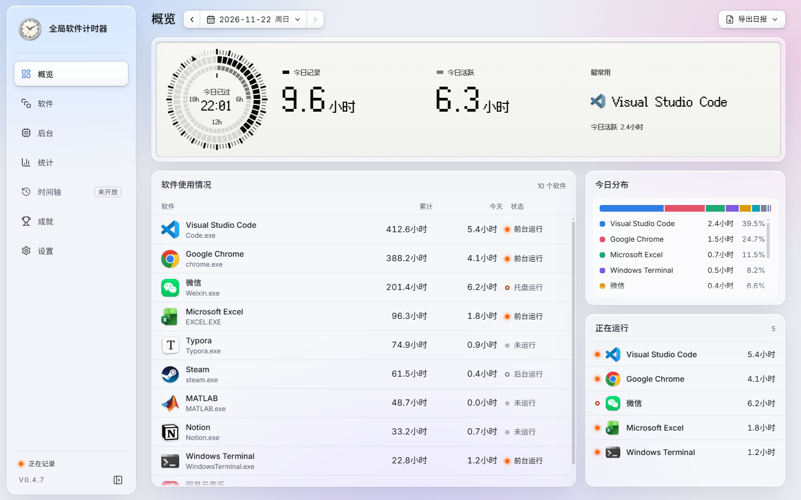
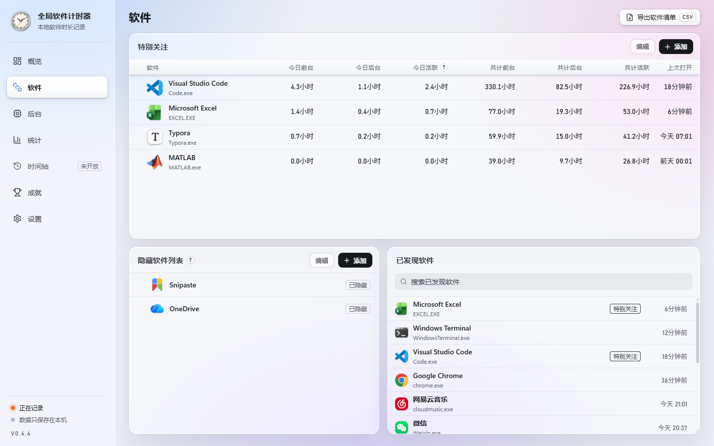
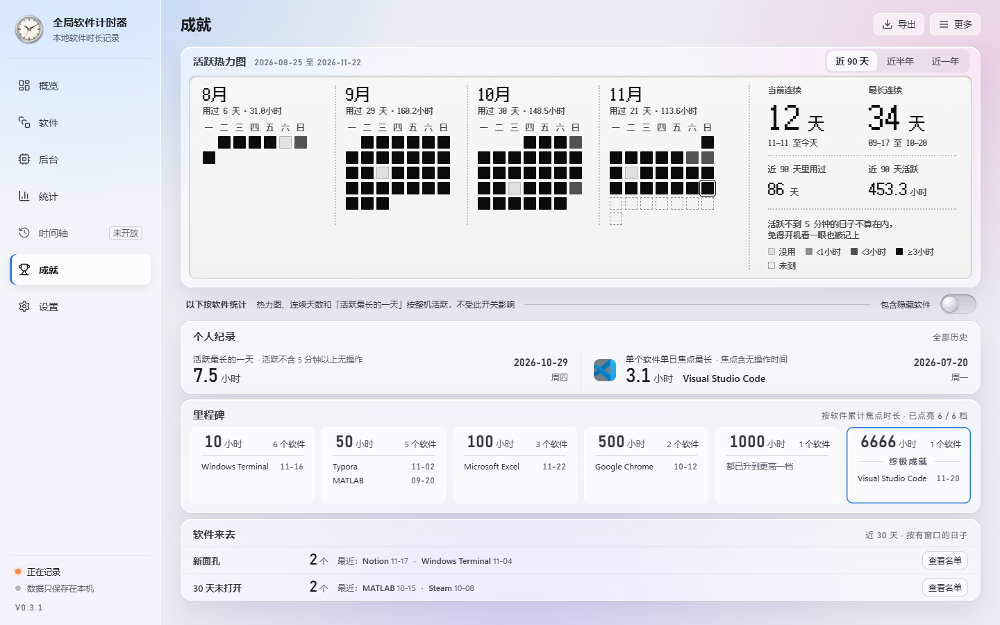
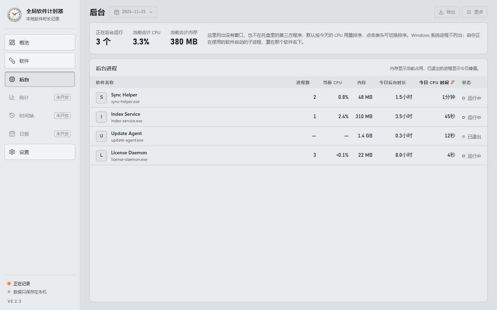
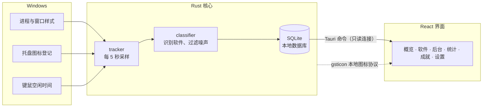

<a id="top"></a>

<div align="center">


# 全局软件计时器

**一台放在桌面角落的计时仪器，替你记下每天的时间都花在了哪些软件上。**

Windows 托盘常驻 · 全自动记录 · 数据只存在本机

<p>
  <a href="https://github.com/Awes0meE/Global-Software-Timer/releases/latest"></a>
  <a href="https://github.com/Awes0meE/Global-Software-Timer/releases"></a>
  
  <a href="./LICENSE"></a>
</p>

<p>
  
  
  
  
  
  
  
  
</p>

<h3>
  <a href="https://github.com/Awes0meE/Global-Software-Timer/releases/latest">⬇️ 下载最新版</a>
  <span>&nbsp;·&nbsp;</span>
  <a href="#features">功能亮点</a>
  <span>&nbsp;·&nbsp;</span>
  <a href="#screenshots">界面一览</a>
  <span>&nbsp;·&nbsp;</span>
  <a href="#privacy">隐私承诺</a>
  <span>&nbsp;·&nbsp;</span>
  <a href="#faq">常见问题</a>
  <span>&nbsp;·&nbsp;</span>
  <a href="#development">参与开发</a>
</h3>

<br />

<picture>
  <source media="(prefers-color-scheme: dark)" srcset="./docs/assets/ui-overview-dark.png" />
  <source media="(prefers-color-scheme: light)" srcset="./docs/assets/ui-overview-light.png" />
  
</picture>

<sub>截图均为示例数据，会跟随 GitHub 的浅色 / 深色主题切换。</sub>

</div>

<br />

一天开着电脑十几个小时，真正在用的是哪几个软件？写代码写了多久，聊天软件挂了多久，哪个程序又在后台悄悄跑了一整天？

**全局软件计时器**（Global Software Timer，简称 GST）在托盘里安静地帮你记下每个软件的运行时长，再用一块像素液晶屏，把今天的数字摆在你面前。不用手动开始，不用联网，不用注册账号。

> 💡 **小贴士**：装好之后基本不用管它。默认开机自启，关掉主窗口也照常记录；想看数据时，点一下右下角托盘里的小时钟就行。

<a id="features"></a>

## ✨ 功能亮点

<table>
  <tr>
    <td width="33%" valign="top">
      <h3>🕒 全自动计时</h3>
      <p>常驻托盘，每 5 秒采样一次，自动识别正在运行的软件。不用点开始、不用点暂停，关掉主窗口也照常记录。</p>
    </td>
    <td width="33%" valign="top">
      <h3>🎯 分清“开着”和“在用”</h3>
      <p><b>今日记录</b>是电脑开着的时间，<b>今日活跃</b>只算 5 分钟内有键鼠操作的部分；软件页还会单独统计每个软件拿到前台焦点的时长。</p>
    </td>
    <td width="33%" valign="top">
      <h3>🧹 自动过滤噪声</h3>
      <p>系统进程、驱动、更新程序、安装程序和各种辅助进程默认不计入；没有窗口、也没有托盘图标的常驻程序集中放在「后台」页。</p>
    </td>
  </tr>
  <tr>
    <td width="33%" valign="top">
      <h3>🔒 数据只在本机</h3>
      <p>所有记录都存在本机的 SQLite 数据库里。不联网、不需要账号、没有遥测，也不读取窗口标题、文档名和网页标题。</p>
    </td>
    <td width="33%" valign="top">
      <h3>🎛️ 桌面仪器质感</h3>
      <p>像素点阵液晶读数窗，配一圈 24 小时分段表盘。浅色 / 深色两套主题，默认跟随 Windows。</p>
    </td>
    <td width="33%" valign="top">
      <h3>🔍 中文友好的搜索</h3>
      <p>已发现软件支持中文、英文、拼音全拼和拼音首字母离线搜索，输入 <code>wx</code> 或 <code>weixin</code> 都能找到「微信」。</p>
    </td>
  </tr>
</table>

还有这些细节：

- 📈 **多天统计**：统计页按近 7 天、本周、本月、近 30 天、今年或自定义区间（最长 366 天）汇总，每个数字都和上一个等长区间对比；能看到每天的记录与活跃时长、软件焦点排行与名次涨跌、「开着没用」的软件、打开次数和作息。
- 🏆 **成就只记录、不设目标**：成就页用点阵热力图摆出近 90 天（可切换半年、一年）用过的日子，再加上连续天数、个人纪录和按软件累计焦点时长点亮的里程碑；没有目标、倒计时，也不发提醒。
- 📦 **小巧**：EXE 安装包不到 4 MB。基于 Tauri，用系统自带的 WebView2 显示界面，不用再打包一整个浏览器。
- 🔄 **升级不断档**：软件更新后换了带版本号的安装目录，仍然算同一个软件，累计时长接着往上加。
- 🧭 **托盘软件也算数**：在 Windows 11 上，最小化到托盘的软件（比如聊天软件）同样计入运行时长。
- ⭐ **特别关注与隐藏**：常用的软件加入特别关注，单独看它的前台、后台和活跃时长；不想看到的软件可以隐藏，记录照常保留。
- ⏱️ **两种时长格式**：默认显示 `8.3小时` 这样的小数小时，也可以在设置里改成 `8小时18分钟`。
- 🚪 **关闭行为自己选**：第一次关闭窗口时会问你是最小化到托盘还是直接退出，之后可以在设置里改。

<a id="screenshots"></a>

## 🖼️ 界面一览

### 软件

特别关注的软件分别显示今日和共计的前台、后台、活跃时长，以及上次打开的时间；下方是隐藏软件列表和可以离线搜索的已发现软件。

<picture>
  <source media="(prefers-color-scheme: dark)" srcset="./docs/assets/ui-software-dark.png" />
  <source media="(prefers-color-scheme: light)" srcset="./docs/assets/ui-software-light.png" />
  
</picture>

### 统计

选一段日期，走纸记录仪式的主图画出每天的记录和活跃时长；下面是按焦点时长的区间排行、开着没用榜、会话和作息，全部和上一个等长区间对比。

<picture>
  <source media="(prefers-color-scheme: dark)" srcset="./docs/assets/ui-statistics-dark.png" />
  <source media="(prefers-color-scheme: light)" srcset="./docs/assets/ui-statistics-light.png" />
  
</picture>

### 成就

液晶屏里按月排开的活跃热力图，配上当前和最长连续天数；下方是个人纪录、10 到 1000 小时的里程碑（6666 小时为终极成就），以及近 30 天新出现和没再打开的软件。

<picture>
  <source media="(prefers-color-scheme: dark)" srcset="./docs/assets/ui-achievements-dark.png" />
  <source media="(prefers-color-scheme: light)" srcset="./docs/assets/ui-achievements-light.png" />
  
</picture>

<table>
  <tr>
    <th width="50%">后台</th>
    <th width="50%">设置</th>
  </tr>
  <tr>
    <td valign="top">
      <picture>
        <source media="(prefers-color-scheme: dark)" srcset="./docs/assets/ui-background-dark.png" />
        <source media="(prefers-color-scheme: light)" srcset="./docs/assets/ui-background-light.png" />
        
      </picture>
      <br />
      没有窗口、也不在托盘里的第三方程序，按软件分组列出实时 CPU、内存、进程数，以及今天的后台时长和 CPU 时间。
    </td>
    <td valign="top">
      <picture>
        <source media="(prefers-color-scheme: dark)" srcset="./docs/assets/ui-settings-dark.png" />
        <source media="(prefers-color-scheme: light)" srcset="./docs/assets/ui-settings-light.png" />
        
      </picture>
      <br />
      开机自启、关闭窗口时的行为、时长显示格式和主题，都在这里一键切换。
    </td>
  </tr>
</table>

<a id="metrics"></a>

## 📊 每个数字是怎么算的

| 指标 | 含义 |
| :-- | :-- |
| **今日记录** | 今天 GST 在运行并记录到的开机时间。 |
| **今日活跃** | 今日记录里，键盘或鼠标在 5 分钟内有操作的部分。 |
| **最常用** | 今天活跃时长最多的软件；今天还没有活跃时长时，取今天运行时长最多的软件。 |
| **前台运行** | 软件有一个任务栏上能看到的窗口。不要求它正被点选，几个软件可以同时处于前台运行。 |
| **托盘运行** | 没有任务栏窗口，但在右下角通知区域有图标（需要 Windows 11）。 |
| **后台运行** | 进程还在，但既没有窗口也没有托盘图标。 |
| **软件页的“活跃”** | 软件拿到 Windows 前台焦点的时间，不看键鼠是否空闲。 |
| **统计、成就页的“焦点”** | 和软件页的“活跃”同一口径。这两页里整台电脑的数字（每日趋势、热力图、连续天数）用今日活跃的键鼠口径，软件的数字（排行、开着没用、里程碑）用焦点。 |
| **开着没用** | 区间内有窗口的时间不少于 5 小时、焦点却不到窗口时间 5% 的软件；托盘和后台时间不算。 |
| **用过 / 没用** | 热力图和连续天数里，活跃不到 5 分钟的日子不算在内，记为“没用”，免得开机看一眼也被记上。 |

> ℹ️ **说明**：概览按软件名称合并，软件页按软件身份汇总，两边的分组和后台口径不同，所以总数不一定完全相等。

<a id="install"></a>

## 📥 下载安装

**系统要求**：Windows 10 / 11（x64）。界面依赖 Microsoft Edge WebView2：Windows 11 已经自带，Windows 10 上缺少时安装程序会自动下载。

1. 打开 [Releases 页面](https://github.com/Awes0meE/Global-Software-Timer/releases/latest)，下载最新版的安装包：

   | 文件 | 说明 |
   | :-- | :-- |
   | `Global.Software.Timer_<版本号>_x64-setup.exe` | **推荐**。EXE 安装包，以后升级直接覆盖安装，原有记录会保留。 |
   | `Global.Software.Timer_<版本号>_x64_en-US.msi` | MSI 安装包，适合需要 MSI 的部署场景。 |
   | `SHA256SUMS.txt` | 校验值，可以用来确认安装包没有损坏或被改动。 |

2. 双击安装。安装包暂时没有数字签名，Windows 可能会提示“Windows 已保护你的电脑”，点 **更多信息 → 仍要运行** 即可。
3. 安装后打开一次，它就会默认开机自启（可以在设置里关闭）。之后在右下角托盘找到小时钟图标，就能随时打开主界面。

<a id="privacy"></a>

## 🔒 隐私承诺

<table>
  <tr>
    <th width="50%">✅ 会记录</th>
    <th width="50%">🚫 不会记录</th>
  </tr>
  <tr>
    <td valign="top">
      <ul>
        <li>软件的可执行文件身份和显示名称</li>
        <li>每个软件的运行时长（前台、托盘、后台）</li>
        <li>今日记录时长，以及按键鼠空闲状态算出的活跃时长</li>
        <li>软件页的特别关注、隐藏标记</li>
        <li>后台程序的路径、后台时长、CPU 时间、内存和进程数峰值</li>
        <li>逐段的焦点、活跃时段，以及每个软件有窗口的时段（只看窗口在不在，不读标题）</li>
        <li>本机设置：开机自启、关闭行为、时长格式、主题</li>
      </ul>
    </td>
    <td valign="top">
      <ul>
        <li>窗口标题</li>
        <li>文档名称</li>
        <li>网页标题和浏览记录</li>
        <li>键盘输入的内容</li>
        <li>鼠标坐标</li>
        <li>文件内容</li>
        <li>任何云端数据</li>
      </ul>
    </td>
  </tr>
</table>

- **不上传、不联网**：不上传任何使用数据，不需要账号，没有遥测。
- **统计和成就不多收集**：这两页只用只读连接读取上面这些已有的本地记录来计算，不新增采集项，也不写入数据库。
- **不要管理员权限**：作为普通程序运行；开机自启用的是当前用户自己的自启动项，同样不需要管理员权限。
- **判断方式透明**：为了区分前台、托盘和后台，GST 只读取窗口样式和类名、进程命令行（只在内存里检查 `--type=` 这类辅助进程标记，不保存），以及 Windows 登记的托盘程序路径；不读取窗口标题，也不读取托盘图标的提示文字。
- **数据放在哪**：
  - 数据库：`%APPDATA%\com.globalsoftwaretimer.app\global-software-timer.sqlite3`
  - 图标缓存（v0.2.4 起）：`%LOCALAPPDATA%\com.globalsoftwaretimer.app\icons\`。只存 96px 的软件图标，文件名是哈希值，不含路径或软件名；写入超过 90 天的图标会在启动时自动清理，也可以随时整个删掉。

完整的隐私声明见 [PRIVACY.md](./PRIVACY.md)（英文）。

<a id="faq"></a>

## ❓ 常见问题

<details>
<summary><b>为什么有些程序没有出现在概览里？</b></summary>
<br />

概览只统计用户真正会用的软件。系统进程、驱动、更新程序、安装程序，以及依附在主程序上的辅助进程（比如浏览器的各种子进程）都会被自动过滤。既没有窗口、也没有托盘图标的常驻程序会出现在「后台」页。

</details>

<details>
<summary><b>关掉窗口以后还会继续记录吗？</b></summary>
<br />

第一次关闭主窗口时会问你：最小化到托盘，还是直接退出。选最小化就会在托盘里继续记录；这个选择之后可以在「设置 → 关闭窗口时最小化到后台」里改。

</details>

<details>
<summary><b>把软件隐藏以后，它的记录会丢吗？</b></summary>
<br />

不会。隐藏的软件照常记录，只是不再出现在概览的排行和今日分布里，统计页和成就页的软件榜单默认也不列出它（打开页面上的「包含隐藏软件」开关就会算进去）；从隐藏列表里移除后，它的历史时长会重新显示。

</details>

<details>
<summary><b>电脑睡眠、或者系统时间被调整，会不会多算时间？</b></summary>
<br />

不会把空白的时间算进去。两次采样之间隔了超过 10 秒（比如电脑睡眠），或者系统时钟往回调了，GST 会在最后一次可靠的采样处结束旧记录，中间那段不计入；跨过午夜的时长会按日期拆到两天里。

</details>

<details>
<summary><b>Windows 提示“已保护你的电脑”怎么办？</b></summary>
<br />

安装包暂时没有代码签名，SmartScreen 会对没签名的新软件弹出这个提示。点 **更多信息 → 仍要运行** 即可。如果担心安装包被改动，可以对照 Releases 里的 `SHA256SUMS.txt` 校验：

```powershell
Get-FileHash .\Global.Software.Timer_0.3.0_x64-setup.exe -Algorithm SHA256
```

</details>

<details>
<summary><b>为什么在 Windows 10 上，托盘里的软件没有算作运行？</b></summary>
<br />

托盘识别依赖 Windows 11 在注册表里登记的通知区域图标。Windows 10 没有这份数据，所以在 Windows 10 上只按窗口来判断。

</details>

<details>
<summary><b>支持 macOS 或英文界面吗？</b></summary>
<br />

暂时不支持。目前只有 Windows 10 / 11 版本，界面为简体中文。

</details>

<a id="roadmap"></a>

## 🗺️ 路线图

- [x] 托盘常驻，自动记录软件运行时长
- [x] 今日记录 / 今日活跃 / 最常用的液晶读数与 24 小时表盘
- [x] 软件页：特别关注、隐藏软件、离线拼音搜索
- [x] Windows 11 托盘软件识别与「后台」进程页
- [x] 浅色 / 深色主题，开机自启与关闭行为设置
- [x] 统计页：周、月、年与自定义区间，和上一个等长区间对比
- [x] 成就页：活跃热力图、连续天数、个人纪录与里程碑
- [ ] 时间轴
- [ ] 数据导出与备份
- [ ] 安装包签名与自动更新
- [ ] macOS 版本

> 🔐 **隐私底线**：任何涉及隐私的新能力（比如更细的检测方式），都必须写清楚会多收集什么，并且默认关闭，由你自己决定是否开启。

<a id="architecture"></a>

## 🏗️ 技术架构



| 层 | 技术 | 负责什么 |
| :-- | :-- | :-- |
| 桌面外壳 | [Tauri v2](https://tauri.app) | 窗口、托盘、开机自启、安装包 |
| 核心 | Rust | 进程扫描、软件识别、计时、存储、Windows 接口 |
| 界面 | React 18 + TypeScript + Vite | 仪表盘与各个页面 |
| 存储 | SQLite（WAL 模式） | 事件、运行会话、每日汇总、逐段时间轴与窗口时段 |

Rust 端的主要模块：

| 模块 | 作用 |
| :-- | :-- |
| `tracker` | 周期采样进程，维护运行会话和心跳，处理采样间隔过长、时钟回拨和跨午夜 |
| `classifier` | 把原始进程归并成用户关心的软件，过滤系统进程和辅助进程 |
| `storage` | 数据库结构与迁移、事件日志、会话、软件身份、每日汇总、时间轴段与窗口段 |
| `activity` | 根据 Windows 的键鼠空闲时间计算活跃时长 |
| `background` | 「后台」页的进程分组和 CPU、内存统计 |
| `statistics` | 统计页和成就页的区间对比、排行、连续天数和里程碑计算 |
| `native_icon` | 读取软件图标并缓存到本机磁盘 |
| `commands` / `tray` | 给界面提供数据接口；托盘菜单与主窗口 |

<a id="development"></a>

## 🧑‍💻 参与开发

**准备环境**：Windows 10 / 11、Node.js 与 npm、Rust（rustup）、Visual Studio 2022 Build Tools、Microsoft Edge WebView2。

```powershell
npm install                 # 安装前端依赖
. .\scripts\dev-env.ps1     # 载入 Rust 和 VS Build Tools 环境（每个新终端执行一次）
npm run tauri:dev           # 启动桌面开发版
```

只改界面的话，不用编译 Rust，直接用示例数据在浏览器里预览：

```powershell
npm run preview:ui          # 打开 http://localhost:1421，可加 ?theme=light|dark、?format=hm、?empty
```

提交前运行完整检查（前端测试与构建、Rust 格式检查与测试、依赖审计），打包时生成 EXE 和 MSI 安装包：

```powershell
npm.cmd run check
npm.cmd run release:build
```

<details>
<summary><b>项目结构</b></summary>
<br />

```text
.
├── src/                    # React + TypeScript 界面
│   ├── components/         # 各页面与表格组件
│   └── assets/             # 时钟图标与像素字体
├── src-tauri/
│   ├── src/                # Rust：采样、识别、存储、托盘、图标
│   ├── tests/              # Rust 集成测试
│   └── windows/            # NSIS 安装包钩子
├── scripts/                # 开发环境、检查与打包脚本
│   └── ui-preview/         # 浏览器预览用的示例数据
├── docs/                   # 现状说明、开发流程、发布说明
├── DESIGN.md               # 界面设计规范
├── PRIVACY.md              # 隐私声明
└── CONTRIBUTING.md         # 贡献指南
```

</details>

开发前建议先读：

- 📘 [当前实现与统计口径](./docs/CURRENT_STATE.md)
- 🔁 [开发流程：分支、检查、评审与发布](./docs/DEVELOPMENT_WORKFLOW.md)
- 🎨 [界面设计规范](./DESIGN.md)
- 🤝 [贡献指南](./CONTRIBUTING.md) · [行为准则](./CODE_OF_CONDUCT.md)
- 📝 [更新日志](./CHANGELOG.md)

欢迎提交 Issue 和 Pull Request。参与开发时请守住这几条底线：

- 保持本地优先，不加遥测，不加网络上传；
- 不默认请求管理员权限；
- 涉及隐私的能力必须写清楚、默认关闭，由用户主动开启。

发现安全问题时，请按 [SECURITY.md](./SECURITY.md) 私下报告，不要直接公开提 Issue。

## 🙏 致谢

- [Tauri](https://tauri.app)：轻量的桌面应用框架，让安装包保持在几 MB。
- [方舟像素字体 Ark Pixel Font](https://github.com/TakWolf/ark-pixel-font)（作者 TakWolf）：液晶读数窗使用的像素字体，以 SIL Open Font License 1.1 授权，随应用打包在 `src/assets/fonts/`，许可文本见 [ark-pixel-OFL.txt](./src/assets/fonts/ark-pixel-OFL.txt)。
- [pinyin-pro](https://github.com/zh-lx/pinyin-pro)：已发现软件的拼音搜索。
- [Lucide](https://lucide.dev)：界面图标。

## 📄 许可证

本项目以 [MIT License](./LICENSE) 开源。

<div align="center">

<br />


<sub>如果它帮你看清了自己的时间，欢迎在右上角点亮一颗 ⭐ 支持一下。</sub>

<sub><a href="#top">回到顶部 ↑</a></sub>

</div>
